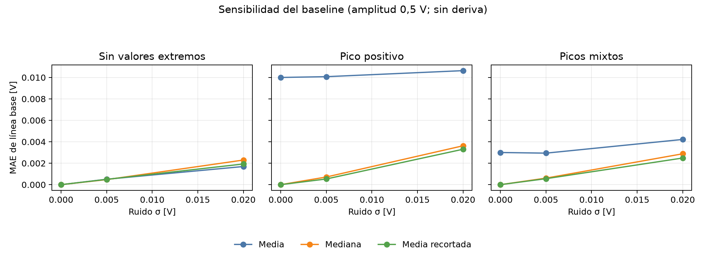
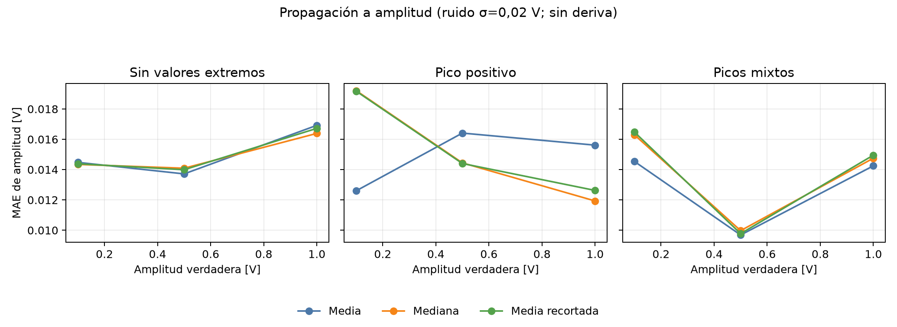

# Primer estudio sintético de sensibilidad al baseline

## Alcance

Este informe resume señales sintéticas positivas con línea base y
pulso triangular conocidos. No contiene registros DRS4 ni demuestra
exactitud sobre datos experimentales. Cada forma de onda fue procesada
por los tres métodos; por tanto, las comparaciones son pareadas.

## Controles de consistencia

| Condición | Método | MAE baseline [V] | MAE amplitud [V] |
|---|---:|---:|---:|
| Limpia | Media | 0.000000 | 0.000000 |
| Limpia | Mediana | 0.000000 | 0.000000 |
| Limpia | Media recortada | 0.000000 | 0.000000 |
| Pico +0,50 V | Media | 0.010000 | 0.010000 |
| Pico +0,50 V | Mediana | 0.000000 | 0.000000 |
| Pico +0,50 V | Media recortada | 0.000000 | 0.000000 |

En el caso limpio y sin ruido, los tres métodos recuperaron los
valores esperados dentro de la precisión numérica. Un valor extremo
de +0,50 V dentro de 50 muestras desplazó la media en +0,010 V; en
esta construcción particular, la mediana y la media recortada no
cambiaron.

## Deriva

La deriva se definió respecto del centro de la región de baseline y
continuó durante el pulso. Por eso un baseline medio aparentemente
correcto no garantiza amplitud ni área correctas si la línea base no
es estacionaria.

| Método | MAE baseline [V] | MAE amplitud [V] | MAE área |
|---|---:|---:|---:|
| Media | 0.000000 | 0.022750 | 2.070000 |
| Mediana | 0.000000 | 0.022750 | 2.070000 |
| Media recortada | 0.000000 | 0.022750 | 2.070000 |

## Mínimos y empates en la grilla

La siguiente cuenta solo identifica el menor MAE de baseline dentro
de cada una de las 54 combinaciones simuladas. No es una clasificación
universal ni pondera condiciones según su frecuencia experimental.

| Método(s) con menor MAE | Condiciones |
|---|---:|
| Media recortada | 26 |
| Mediana + Media recortada | 12 |
| Media | 6 |
| Media + Mediana + Media recortada | 6 |
| Mediana | 4 |

## Figuras

## Limitaciones

- Los pulsos son triangulares, positivos y generados por un modelo
  deliberadamente simple.
- Los valores extremos y la deriva son escenarios elegidos, no una
  caracterización de un instrumento DRS4 específico.
- El menor error depende de la distribución simulada y del tamaño de
  la ventana de línea base.
- La fase experimental deberá conservar procedencia, canales y
  adquisiciones separados, y no dispondrá de un baseline verdadero.
