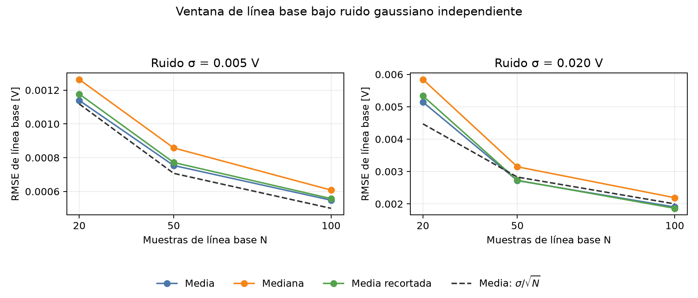
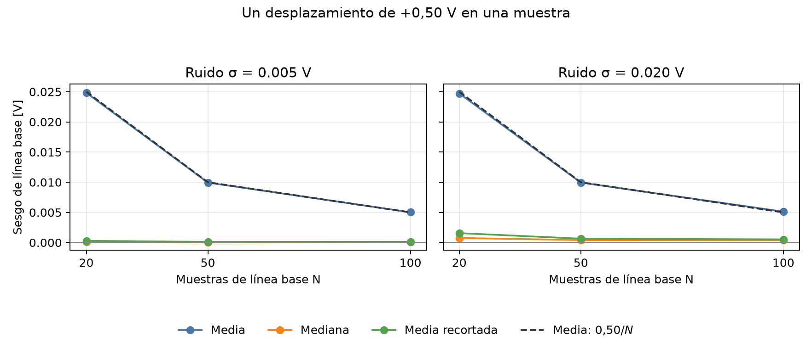

# Longitud de la ventana de línea base: estudio sintético

## Pregunta

¿Cómo cambia la estimación de la línea base al usar 20, 50 o 100
muestras, tanto con ruido gaussiano independiente como con valores
extremos controlados? El diseño es pareado: cada forma de onda se
procesó con todas las ventanas y métodos, manteniendo fija la región
de señal.

## Alcance

Este informe usa exclusivamente señales sintéticas. No contiene
registros DRS4, no determina una ventana óptima para un instrumento
real y no representa una eficiencia física de detección.

## Control analítico: ruido limpio

Para muestras independientes con ruido gaussiano de desviación
estándar σ, la media de N muestras tiene un RMSE esperado
σ/√N. La simulación se aproxima a esa referencia; las diferencias
residuales son compatibles con la estimación mediante 100 eventos
por condición.

| σ [V] | N | RMSE media observado [V] | σ/√N [V] |
|---:|---:|---:|---:|
| 0.005 | 20 | 0.001139 | 0.001118 |
| 0.005 | 50 | 0.000754 | 0.000707 |
| 0.005 | 100 | 0.000548 | 0.000500 |
| 0.020 | 20 | 0.005145 | 0.004472 |
| 0.020 | 50 | 0.002719 | 0.002828 |
| 0.020 | 100 | 0.001902 | 0.002000 |

## Contaminación positiva controlada

Se añadió +0,50 V a una sola muestra de la región de línea base.
Para la media, el sesgo esperado es 0,50/N: una ventana mayor
diluye ese valor extremo, pero no lo rechaza. La mediana y la media
recortada presentaron mucho menos sesgo en este escenario particular.

| N | Sesgo media observado [V] | 0,50/N [V] | MAE mediana [V] | MAE recortada [V] |
|---:|---:|---:|---:|---:|
| 20 | 0.024828 | 0.025000 | 0.001146 | 0.000939 |
| 50 | 0.009940 | 0.010000 | 0.000627 | 0.000584 |
| 100 | 0.005024 | 0.005000 | 0.000459 | 0.000373 |

## Interpretación limitada

- En el modelo limpio, aumentar N reduce la variación de los tres
  estimadores; para la media aparece la dependencia esperada 1/√N.
- Ante un único pico positivo fijo, aumentar N reduce el sesgo de
  la media como 1/N. Los estimadores robustos responden mejor a esta
  contaminación concreta, pero eso no establece un ganador universal.
- En el pulso pequeño del barrido, los escenarios con valores extremos
  cambiaron también la estimación de ruido y la decisión de detección.
  Ese efecto requiere un diagnóstico separado antes de interpretarlo.

## Limitaciones y siguiente paso

- El ruido es gaussiano e independiente; no incluye correlación,
  oscilaciones, deriva temporal ni estructura de canales DRS4.
- Los valores extremos tienen posiciones y magnitudes fijadas por el
  diseño, no por una caracterización experimental.
- Las ventanas no contienen señal en este estudio; falta estudiar
  contaminación por llegada temprana del pulso.
- Antes de aplicar el método a registros reales se debe conservar la
  procedencia de los datos y definir criterios sin usar una línea base
  verdadera, que en una adquisición no está disponible.
