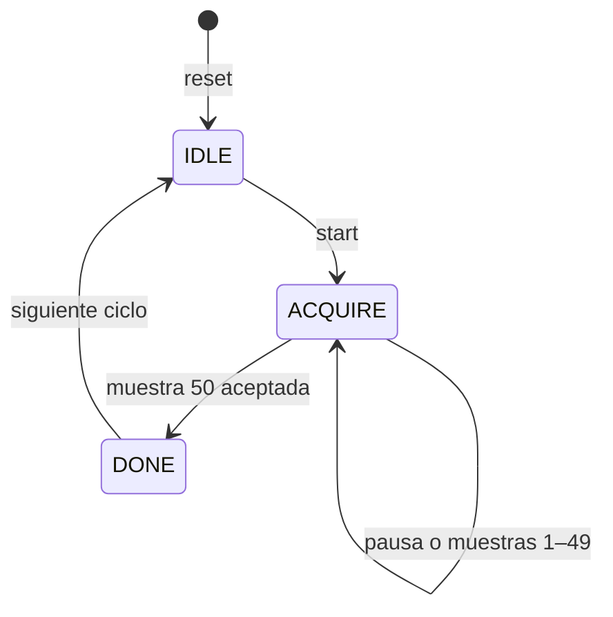

# Guía de aprendizaje: nuestro primer estimador de línea base en FPGA

## 1. ¿Qué estamos intentando construir?

Una forma de onda digitalizada es una secuencia de números que representa cómo
cambia una señal eléctrica en el tiempo. Antes de medir un pulso necesitamos
estimar su **línea base**: el nivel que tendría la señal en ausencia del pulso.
Una estimación incorrecta se propaga a la amplitud, el área y otras magnitudes.

En este proyecto comenzamos estudiando registros experimentales adquiridos por
un equipo colaborador con DRS4 y, por separado, construimos herramientas propias
para analizar formas de onda y señales sintéticas. No atribuimos al estudiante
la adquisición ni la operación física de ese instrumento. El núcleo FPGA de
esta guía también es un desarrollo propio y separado: no consume esos registros
experimentales ni pretende reproducir la arquitectura interna del DRS4.

La conexión es metodológica. Si una etapa de procesamiento necesita calcular
repetidamente una línea base, podemos preguntar cómo expresar una versión
digital sencilla de ese cálculo como hardware. Nuestro primer caso usa la media
de 50 muestras enteras. Es deliberadamente pequeño: permite estudiar precisión
numérica, sincronización y verificación antes de abordar interfaces o algoritmos
más complejos.

## 2. Fundamentos necesarios

### FPGA, RTL y SystemVerilog

Una **FPGA** es un circuito integrado cuya lógica digital puede configurarse.
No cargamos un programa que un procesador ejecuta instrucción por instrucción;
describimos una red de registros, operaciones y conexiones que puede trabajar
en paralelo.

**RTL** significa *Register Transfer Level*. En este nivel describimos qué datos
guardan los registros y cómo cambian de un ciclo de reloj al siguiente.
**SystemVerilog** es el lenguaje usado aquí para escribir esa descripción. Una
sentencia dentro de un bloque secuencial no debe interpretarse automáticamente
como una línea de Python: contribuye a definir el circuito y su comportamiento
temporal.

### Del algoritmo Python a una descripción de hardware

En Python podemos recibir una lista completa, sumar sus elementos y devolver la
media. El entorno oculta muchos detalles: tamaño de cada número, memoria y tiempo
de cada operación. En RTL debemos fijar esas decisiones:

- cuántos bits tiene cada muestra;
- cuántas muestras se han recibido;
- cuándo una entrada es válida;
- qué ocurre si una muestra se retrasa;
- cuándo está disponible el resultado;
- cuántos bits necesita la suma para no desbordarse.

Por eso mantenemos dos implementaciones. `src/fixed_point.py` es la referencia
entera fácil de inspeccionar. `fpga/rtl/baseline_mean.sv` describe el núcleo.
Ambas obedecen el mismo contrato numérico, pero no son el mismo tipo de sistema.

### Muestras, bits, registros y reloj

Cada muestra es un entero sin signo de 12 bits. Doce bits representan desde 0
hasta `2^12 - 1 = 4095`. Un **registro** conserva un valor entre ciclos. En este
núcleo hay registros para la suma acumulada, el contador, el estado y la salida.

El **reloj** organiza los cambios. En cada flanco ascendente evaluamos si se
acepta una muestra. Una muestra solo entra cuando `sample_valid` y
`sample_ready` valen 1 al mismo tiempo. Si `sample_valid=0`, el circuito espera:
no inventa una muestra ni avanza el contador.

### Simulación, testbench, síntesis e implementación física

Son etapas distintas:

1. Una prueba Python comprueba la referencia numérica.
2. La **simulación RTL** ejecuta la descripción con un simulador. Un
   **testbench** genera reloj, reset, muestras y pausas, y comprueba las salidas.
3. La **síntesis** transforma el RTL en una red genérica de elementos lógicos y
   detecta problemas como módulos ausentes o latches no deseados.
4. La **implementación física** asignaría esa red a una FPGA específica,
   realizaría place-and-route, analizaría tiempos y programaría una placa.

En este proyecto completamos las tres primeras comprobaciones. No hemos
implementado ni probado el núcleo en hardware físico.

## 3. Nuestro primer núcleo

El contrato completo está en [architecture.md](architecture.md). Recibimos 50
muestras U12 y calculamos:

```text
S = suma de las 50 muestras
baseline = (S + 25) // 50
```

El máximo acumulable es `50 × 4095 = 204750`. Un registro de 17 bits no basta,
porque llega solo hasta 131071. Uno de 18 bits llega hasta 262143, por lo que sí
contiene la suma. El contador utiliza 6 bits: puede representar desde 0 hasta 63
y, en particular, los valores 0 a 50.

Sumamos 25 antes de dividir por 50 para redondear al entero más cercano. Como
las entradas nunca son negativas, los casos exactamente a mitad de camino se
redondean hacia arriba.

### Ejemplo numérico

Supongamos 25 muestras con valor 1000 y 25 con valor 1001:

```text
S = 25 × 1000 + 25 × 1001
S = 25000 + 25025 = 50025
media exacta = 50025 / 50 = 1000,5
resultado entero = (50025 + 25) // 50
resultado entero = 50050 // 50 = 1001
```

El ejemplo cae justo en un empate y confirma la regla de redondeo.

### Estados y señales

El núcleo usa una máquina de estados con tres etapas:



- `IDLE` espera `start`. El ciclo que acepta `start` no consume muestras.
- `ACQUIRE` mantiene `sample_ready=1`. Cada coincidencia con `sample_valid=1`
  suma una muestra y aumenta el contador.
- `DONE` mantiene `result_valid=1` durante un ciclo. `baseline_out` contiene el
  resultado y luego permanece estable hasta otro resultado o reset.

El reset es síncrono y tiene prioridad. Un `start` durante `ACQUIRE` se ignora,
y una secuencia incompleta espera sin timeout. Esto evita ambigüedades, aunque
todavía no ofrece colas ni varias transacciones simultáneas.

## 4. Reproducción en Arch Linux / Omarchy

Omarchy se basa en Arch Linux, por lo que podemos instalar las herramientas con
`pacman`. Estos comandos requieren privilegios administrativos y se muestran
para reproducción; la guía no ejecuta instalaciones automáticamente.

```bash
sudo pacman -S --needed python iverilog yosys
```

Desde la raíz del repositorio:

```bash
cd /home/minimodecoro/Projects/drs4-waveform-baseline-study
python -m unittest tests.test_fixed_point -v
python -m fpga.verify
```

El primer comando comprueba casos manuales, límites, tipos inválidos,
determinismo e inmutabilidad de la referencia. El segundo realiza cuatro pasos:

1. repite las pruebas numéricas Python;
2. confirma mediante un control negativo que el comparador detecta una salida
   alterada deliberadamente, sin modificar el RTL;
3. genera vectores deterministas y ejecuta el testbench con Icarus Verilog;
4. compara los números realmente escritos por la simulación con Python y pide a
   Yosys una síntesis genérica.

Los archivos de vectores, ejecutables y resultados intermedios se crean en un
directorio temporal y se eliminan al terminar. Entre los vectores existen casos
manuales, valores pseudoaleatorios con semilla fija y regiones producidas por el
generador sintético existente. Estas últimas se convierten explícitamente desde
voltaje a U12; no se utilizan registros experimentales.

Interpretamos el resultado así:

- `PASS`: esa comprobación se ejecutó y no encontró diferencias.
- `FAIL`: se ejecutó y encontró un error; no debemos presentar el hito como
  validado.
- `BLOCKED`: faltó una herramienta necesaria, por ejemplo el simulador.
- Una cantidad de discrepancias mayor que cero significa que Python y la salida
  emitida por el RTL no coincidieron para uno o más bloques.

La síntesis genérica confirma que Yosys puede elaborar el módulo, convertir sus
procesos en lógica y registros y revisarlo sin problemas estructurales. También
permite inspeccionar celdas genéricas como sumadores, multiplexores y división
constante. No entrega por sí sola LUT, frecuencia máxima, consumo, pines ni
comportamiento eléctrico de una FPGA particular. Para eso necesitamos elegir
dispositivo, ejecutar su flujo de implementación y probar una placa.

## 5. Aprendizaje activo

### Ejercicio 1: ampliar el bloque

Queremos promediar 100 muestras U12. ¿Cuántos bits requieren acumulador y
contador? ¿Qué expresión mantiene el mismo redondeo?

**Solución.** La suma máxima es:

```text
100 × 4095 = 409500
2^18 = 262144 < 409500 < 524288 = 2^19
```

Necesitamos 19 bits para el acumulador. Para representar de 0 a 100, el contador
necesita 7 bits, porque 6 bits llegan hasta 63. La media sería
`(S + 50) // 100`: sumamos la mitad del divisor antes de la división. Esta
respuesta dimensiona los números, pero cambiar el núcleo exigiría además adaptar
contrato, RTL y pruebas.

### Ejercicio 2: pausas durante una transacción

Después de `start`, llegan tres ciclos con estas parejas
`(sample_valid, sample_ready)`: `(1,1)`, `(0,1)`, `(1,1)`. ¿Cuántas muestras se
aceptan y qué ocurre con la suma durante el segundo ciclo?

**Solución.** Se aceptan dos muestras: la primera y la tercera. En el ciclo
intermedio `sample_valid=0`, por lo que el contador y el acumulador conservan su
valor. La transacción no termina por tiempo transcurrido, sino después de 50
coincidencias válidas. El testbench introduce pausas para verificar exactamente
este comportamiento.

### Limitaciones y siguiente paso técnico

El núcleo solo calcula una media fija de 50 códigos U12, procesa una transacción
a la vez y no incluye interfaz física, FIFO, timeout ni backpressure de salida.
La división por 50 sigue representada como operación genérica en la síntesis.
El siguiente paso técnico, fuera de este hito, sería seleccionar una FPGA y su
flujo de herramientas para comprobar utilización, temporización y funcionamiento
en placa sin confundir esos resultados con la adquisición DRS4 compartida.
